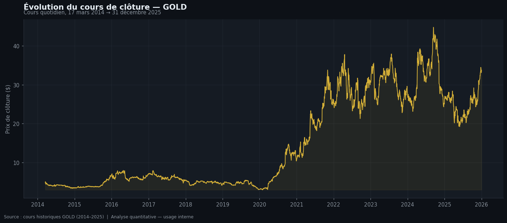
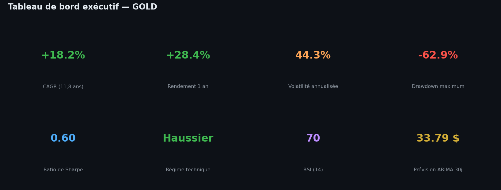
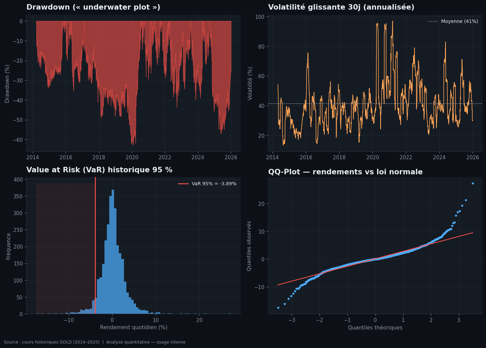
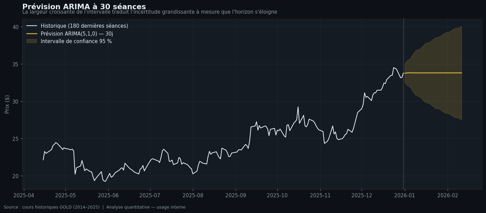

# Analyse quantitative d'une action boursière sur 12 ans — GOLD (2014-2025)


Analyse quantitative complète de l'action cotée sous le ticker **GOLD**, sur **2 968 séances** (17 mars 2014 → 31 décembre 2025) : performance, indicateurs techniques, mesures de risque, séries temporelles, Machine Learning, ARIMA et LSTM. Le tout débouche sur un **tableau de bord de décision d'investissement**.



---

## Sommaire
- [Données](#données)
- [Résultats clés](#résultats-clés)
- [Méthodologie](#méthodologie)
- [Modélisation prédictive](#modélisation-prédictive)
- [Installation et exécution](#installation-et-exécution)
- [Structure du dépôt](#structure-du-dépôt)
- [Limites](#limites)
- [Avertissement](#avertissement)
- [Auteur](#auteur)

---

## Données

| Élément | Valeur |
|---|---|
| Fichier | `data/gold_stock.csv` (export Yahoo Finance) |
| Actif | Action cotée sous le ticker `GOLD` (à ne pas confondre avec le cours de l'or) |
| Période | 17/03/2014 → 31/12/2025 (11,8 ans) |
| Fréquence | Quotidienne : 2 968 séances |
| Colonnes | `Date, Open, High, Low, Close, Volume` |
| Qualité | 0 valeur manquante, 0 date dupliquée |

## Résultats clés



### Performance
| Indicateur | Valeur |
|---|---:|
| Rendement annuel composé (CAGR) | **+18,2 %** |
| Rendement sur 1 an / 3 ans / 5 ans / 10 ans | +28,4 % / +10,2 % / +218,0 % / +396,9 % |
| Meilleure année | 2020 (+244,6 %) |
| Pire année | 2019 (−32,0 %) |
| Années positives | 6 sur 12 |

### Risque
| Mesure | Valeur |
|---|---:|
| Volatilité annualisée | 44,3 % |
| Volatilité baissière annualisée | 29,5 % |
| Drawdown maximum | **−62,9 %** |
| VaR quotidienne 95 % / 99 % (historique) | −3,89 % / −7,19 % |
| CVaR (Expected Shortfall) 95 % | −6,01 % |
| Ratio de Sharpe / Sortino / Calmar (rf = 0) | 0,60 / 0,90 / 0,29 |

Les rendements quotidiens présentent une asymétrie de +0,65 et un **excès de kurtosis de +8,54** : les mouvements extrêmes sont nettement plus fréquents que ne le prévoit une loi normale.



## Méthodologie

| # | Étape | Contenu |
|---|---|---|
| 1 | Configuration | Thème graphique, fonctions de mise en forme |
| 2 | Chargement et nettoyage | Lecture de l'export Yahoo Finance, contrôle des manquants et des doublons |
| 3 | Analyse exploratoire | Distribution des rendements, asymétrie, kurtosis, QQ-plot |
| 4 | Tendance et performance | Base 100, CAGR, rendements glissants et annuels |
| 5 | Indicateurs techniques | SMA 50/200 (golden / death cross), bandes de Bollinger, RSI(14), MACD, codés **sans bibliothèque externe** |
| 6 | Risque quantitatif | Volatilité, drawdown, VaR / CVaR historiques, ratios de Sharpe, Sortino et Calmar |
| 7 | Séries temporelles | Test de stationnarité ADF, décomposition STL |
| 8 | Machine Learning | Régression (prix du lendemain) et classification (hausse / baisse), découpage chronologique strict |
| 9 | ARIMA(5,1,0) | Prévision à 30 séances avec intervalle de confiance à 95 % |
| 10 | Tableau de bord | Synthèse et recommandation générée à partir des indicateurs |
| 11 | Deep Learning | LSTM (Keras / TensorFlow) sur des fenêtres de 30 rendements |

**Stationnarité :** le prix n'est pas stationnaire (ADF p = 0,74), alors que les rendements le sont (p < 0,001). C'est le comportement d'une marche aléatoire avec dérive, ce qui justifie de modéliser les **rendements** plutôt que le prix brut.

## Modélisation prédictive

**Découpage chronologique :** les ~10,5 premières années servent à l'entraînement, et la dernière année (**252 séances**, 27/12/2024 → 30/12/2025) sert de test. Il n'y a aucun mélange temporel. Le modèle utilise **16 variables** : rendements retardés, moyennes et écarts-types glissants, position du prix par rapport aux SMA 20 et 50, RSI et MACD retardés, variation du volume, jour de la semaine et mois.

### Régression : prix de clôture du lendemain (jeu de test)
| Modèle | RMSE ($) | MAE ($) | MAPE (%) | R² |
|---|---:|---:|---:|---:|
| **Naïf (rendement nul)** | **0,674** | **0,491** | **2,00** | 0,956 |
| Random Forest | 0,677 | 0,494 | 2,02 | 0,956 |
| Régression linéaire | 0,682 | 0,498 | 2,03 | 0,955 |

### Classification : sens du mouvement du lendemain
Le Random Forest atteint une accuracy de 50,2 %, contre 46,6 % pour le classifieur naïf, avec un **AUC-ROC de 0,48**.

### LSTM
RMSE de **0,673 $** contre **0,674 $** pour le modèle naïf.

### ARIMA(5,1,0)
Prévision à 30 séances : **33,79 $**, avec un intervalle de confiance à 95 % de [27,51 $ ; 40,07 $], soit ±18,6 %.



### Conclusion
Aucun modèle (Random Forest, régression, LSTM) ne bat significativement le **modèle naïf**, et l'AUC de classification est proche de 0,5. Ce résultat est **cohérent avec l'hypothèse d'efficience des marchés** : le cours quotidien se comporte presque comme une marche aléatoire. Un score nettement meilleur aurait plutôt signalé une fuite de données ou du surapprentissage. La valeur de l'analyse est donc dans la **mesure du risque** et dans la **rigueur de l'évaluation** : chaque modèle est comparé à une référence naïve, sur un découpage strictement chronologique.

## Installation et exécution

```bash
git clone https://github.com/Minyurano/Analyse-quantitative-d-une-action-boursi-re-12-ans-de-donn-es-Python-scikit-learn-TensorFlow-ARIMA.git
cd Analyse-quantitative-d-une-action-boursi-re-12-ans-de-donn-es-Python-scikit-learn-TensorFlow-ARIMA
pip install -r requirements.txt

python src/analyse_gold.py              # analyse complète (sections 1 à 11)
```
- **Sans TensorFlow :** `SKIP_LSTM=1 python src/analyse_gold.py` sous Linux / macOS, ou `$env:SKIP_LSTM=1; python src/analyse_gold.py` sous PowerShell.
- Les graphiques sont enregistrés dans `outputs/`.
- **Sur Kaggle :** importer `notebooks/analyse_gold.ipynb`, attacher `gold_stock.csv`, puis **Run All**.

Les résultats peuvent varier très légèrement selon les versions des bibliothèques. Les chiffres de ce README proviennent de l'exécution de référence sur Kaggle (notebook).

## Structure du dépôt

```
.
├── src/
│   └── analyse_gold.py          # Analyse complète (exécutable en script)
├── notebooks/
│   └── analyse_gold.ipynb       # Exécution de référence sur Kaggle, avec sorties
├── data/
│   └── gold_stock.csv           # Cours quotidiens 2014-2025
├── assets/                      # Graphiques des résultats
├── .github/workflows/ci.yml     # Intégration continue : exécution de l'analyse
├── requirements.txt
├── LICENSE
└── README.md
```

## Limites
- **Un seul actif :** les conclusions ne se généralisent pas sans les tester sur d'autres titres.
- **Aucun coût de transaction ni glissement** dans l'évaluation des signaux.
- **ARIMA(5,1,0)** a un ordre fixé, sans recherche systématique (critère AIC, auto-ARIMA).
- **La volatilité n'est pas constante :** un modèle GARCH serait plus adapté pour prévoir le risque.
- **La recommandation est générée par des règles** à partir des indicateurs, ce n'est pas un modèle de décision optimisé.

## Avertissement

Projet à **but pédagogique**. Les analyses et prévisions **ne constituent pas un conseil en investissement**. Les performances passées ne préjugent pas des performances futures.

## Auteur

**Aloys MINYURANO** — Master Intelligence Artificielle & Sciences des Données (IASD), FST de Tanger
[GitHub](https://github.com/Minyurano) · [LinkedIn](https://www.linkedin.com/in/aloys-minyurano-871717402)

Distribué sous licence [MIT](LICENSE).
